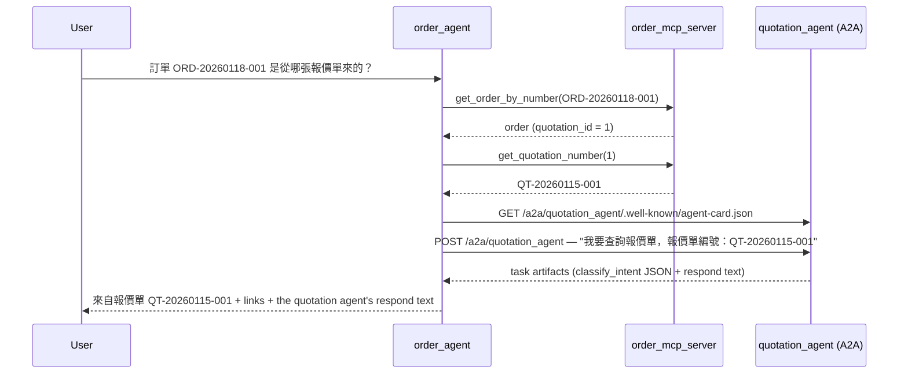

# EZStore order & customer service agent (`order_agent`)

A **read-only** assistant for EZStore orders, built with Google ADK 2.x as a **graph Workflow** on the same pattern as the quotation agent (`agent/`). It answers four kinds of questions:
- an order's details;
- a customer's orders;
- what an order status means, answered only from the OKF knowledge bundle;
- which quotation an order came from, by asking the quotation agent over **A2A**.

Write requests are refused in code. The ADK app name is `order_agent`. The spec is [agent2-spec-prompt.md](../agent2-spec-prompt.md).

## Project layout

```
order_agent/
├── order_agent/
│   ├── agent.py          # the Workflow graph: Intent schema, nodes, routing rules, App
│   ├── prompts.py        # classifier instruction + every fixed reply
│   ├── knowledge.py      # reads the OKF bundle (status → concept file, by code)
│   ├── a2a_client.py     # asks the quotation agent over A2A
│   ├── fast_api_app.py   # ADK FastAPI server (/run_sse, dev UI, own A2A card)
│   └── app_utils/        # scaffold helpers: shared session service, A2A routes
├── knowledge/            # OKF knowledge bundle (see below); copied into the Docker image
├── tests/
│   ├── unit/             # routing, knowledge bundle checks, A2A reply filtering — no LLM, no MCP
│   ├── integration/      # whole graph with a fake classifier + real order MCP; A2A faked or unreachable
│   └── eval/             # agents-cli eval: datasets, eval_config.yaml, metric code
├── Dockerfile            # image for the `order-agent` Compose service (port 8080)
├── pyproject.toml / uv.lock
└── .env.example          # copy to .env for local runs
```

The order data comes from **`order_mcp_server/`**, a separate read-only MCP server. Its three tools only send `GET` requests to the backend:
- `get_order_by_number` lists the orders and matches the number itself, because the backend has no `order_number` filter.
- `list_customer_orders` returns `result: "ambiguous"` with the candidates when several customers match.
- `get_quotation_number` turns a quotation ID into its number.

## Graph design

```
START → load_context → classify_intent (LLM, output_schema=Intent) → route
          ├─ get_order / list_customer_orders                       ← one order MCP tool each
          ├─ explain_status                                         ← OKF bundle only
          ├─ order_quotation ─has_quotation→ find_quotation_number ─found→ ask_quotation_agent (A2A)
          │        └─done (no quotation / not found)─────────┐             └─done─┐
          ├─ clarify      (missing fields → ask, remember state.pending_intent)
          ├─ read_only    (create/cancel/change/delete → fixed refusal, ADR 0001)
          ├─ off_topic    (fixed refusal)
          └─ model_error  (LLM unavailable → straight to respond)
        all → respond     (the reply; updates state)
```

`classify_intent` is the **only LLM call**. `route` decides everything else in code:

- **Arguments:** regexes read the order number (`ORD-YYYYMMDD-NNN`, any case), the customer name and the status from the message. Statuses are recognized in both languages: pending / 待處理, confirmed / 已確認, completed / 已完成, cancelled / canceled / 已取消.
- **Read-only (spec 1.5):** these requests go to `read_only`, whatever the LLM said:
  - 新增/取消/修改/刪除… + 訂單/客戶/產品
  - 把…訂單…取消
  - English `cancel / delete / update … order / customer / product`

  Status words such as 已取消 are not treated as verbs.
- **Operation named, fields missing (spec 1.7):** if the LLM says `unclear` or `off_topic` but the message names an operation (查詢訂單 / Look up an order, 客戶的訂單清單, 狀態…是什麼意思, 從哪張報價單來), that operation is used. Its missing field is asked for, and the next message completes it.
- **Off-topic (spec 1.6):** an operation needs order vocabulary (訂單, ORD-…, 客戶, 狀態, order, customer, status…), unless the message answers a pending question.
- **Ambiguous customer:** the reply lists the candidates. The next message can be a number from the list or the name.
- **Multi-turn without state:** when a session is seeded with earlier turns as plain events (as `agents-cli eval` does), the history is rebuilt from the events and the agent's own clarification question is recognized.

## Knowledge bundle (`knowledge/`, Open Knowledge Format)

```
knowledge/
├── index.md            # every concept ID + its one-line summary (read this first)
├── log.md              # dated changes
├── glossary/           # order-status-pending / -confirmed / -completed / -cancelled
├── playbooks/          # order-fulfillment: the order lifecycle
├── decisions/          # ADR 0001 read-only, ADR 0002 quotation questions via A2A
├── systems/            # ezstore-orders: order fields and API limits
└── lessons/            # 0001: the eval judge that needed Vertex AI billing (blameless)
```

- **One concept per file.** The concept ID is the path without `.md`, e.g. `glossary/order-status-pending`.
- **Frontmatter** has `type` (index / log / glossary / playbook / decision / system / lesson), `title`, `summary` and `sources` (`id` + repo path). Claims cite those sources as footnotes `[^id]`.
- **How the agent uses it:** concepts are chosen **by code**, not by search. A status maps to `glossary/order-status-<status>.md`; there is no vector database.
  - An order's status line uses that file's `summary`.
  - A status question is answered from its 意義 / 常見的下一步 / 聯絡窗口 sections.

  Both end with `來源：<concept ID>`.

**Adding a concept:**
1. Create `knowledge/<folder>/<name>.md` with frontmatter (`type`, `title`, a one-line `summary`, `sources` with repo paths) and a body whose claims cite those sources as footnotes.
2. Add a row with its concept ID and summary to `index.md`, and a dated line to `log.md`.
3. Link related concepts by writing their ID in backticks, e.g. `` `decisions/0001-order-agent-read-only` ``.
4. If the agent should use it, map to it in `knowledge.py`, like `status_concept_id`.
5. Run `uv run pytest tests/unit/test_knowledge.py -q`. It checks the frontmatter, that every source path exists, that every footnote is defined and used, that concept links resolve, and that the index lists every concept.

## A2A: order agent → quotation agent



- **Only code-built sentences are sent.** The user's text is never forwarded (ADR 0002), so it can't make the quotation agent copy, reprice or convert anything.
- **Only the `respond` text is used.** ADK's A2A server tags each artifact with its event author (`adk_author`). Text authored by `quotation_agent` is the `respond` node's; the classifier's JSON, authored by `classify_intent`, is dropped.
- **`QUOTATION_AGENT_URL` is always used**, both to fetch the card and to send. The card advertises `http://agent:8080/…`, which only resolves inside Compose.
- **Unreachable quotation agent:** the reply still gives the quotation number and both links, plus `目前無法連線報價單助理（…）`.
- **No source quotation:** if the order has no `quotation_id`, the reply says `不是由報價單轉來的` and no A2A call is made.
- **Its own card:** the order agent serves one at `/a2a/order_agent/.well-known/agent-card.json`.

## Configuration

Set these in `order_agent/.env` for local runs. Docker Compose sets them for the `order-agent` service from the root `.env`.

| Variable | Default | Purpose |
|---|---|---|
| `GEMINI_API_KEY` (or the Vertex AI variables) | — | model credentials, same as `agent/` |
| `AGENT_MODEL` | `gemini-3.8-flash` | model for `classify_intent` |
| `JUDGE_MODEL` | `AGENT_MODEL` | model for the eval LLM judges |
| `MCP_URL` | `http://localhost:8011/mcp` | order MCP server. Compose: `http://order-mcp-server:8000/mcp` |
| `QUOTATION_AGENT_URL` | `http://localhost:8081/a2a/quotation_agent` | quotation agent's A2A endpoint. Compose: `http://agent:8080/a2a/quotation_agent` |
| `KNOWLEDGE_DIR` | `order_agent/knowledge` | knowledge bundle location |
| `GOOGLE_CLOUD_PROJECT` | — | used by `agents-cli eval` (with gcloud credentials) |

## How to run

**Everything in Docker** (from the repo root):
```bash
docker compose -f docker-compose.yml -f docker-compose.build.yml up -d --build
docker compose exec db psql -U ezstore -f /scripts/seed-test-data.sql
```
- **Order agent's ADK dev UI:** http://localhost:8502/dev-ui/ (pick `order_agent`).
- **Its API:** `/apps/order_agent/users/<user>/sessions` and `/run_sse` on port 8502.
- **Ports:**
  - the order MCP server is published on **8011**;
  - the quotation agent's A2A endpoint on **127.0.0.1:8081** (localhost only).

  Both are for local runs.

**Locally** (the agent on your machine, the other services in Docker):
```bash
cd order_agent
cp .env.example .env                 # fill GEMINI_API_KEY; MCP_URL / QUOTATION_AGENT_URL defaults fit Compose
uv sync --group dev --extra eval
agents-cli playground --port 8503    # 8080 is the backend, 8502 the Docker order-agent
agents-cli run "我要查詢訂單，訂單編號：ORD-20260118-001"
```
If the `order-agent` container is stopped, the playground can use 8502 instead.

**Tests** (no model calls):
```bash
uv run pytest tests/unit -q          # routing, knowledge bundle, A2A reply filtering
uv run pytest tests/integration -q   # whole graph, fake classifier, real order MCP (skipped if down)
RUN_LLM_TESTS=1 uv run pytest tests/integration -q   # also the real-model tests
```

Each chat message costs one model call. A source-quotation question costs one more, on the quotation agent.

## Evaluation

Two datasets in `tests/eval/datasets/`, scored on the same four metrics as `agent/` with the same local LLM judges. See [agent/README.md](../agent/README.md), "Evaluation", for why `refusal_or_action` runs as a local judge and for `JUDGE_MODEL`.

| Dataset | Cases |
|---|---|
| `order-actions.json` | `get_order`, `list_customer_orders`, `explain_status_pending`, `order_quotation` (spec 1.1–1.4) |
| `order-guardrails.json` | `read_only_cancel_order`, `off_topic_weather`, `clarify_then_complete` (2 turns), `not_found_order`, `markdown_request` |

```bash
gcloud auth application-default login      # once: agents-cli's grader needs gcloud credentials
agents-cli eval run --dataset tests/eval/datasets/order-guardrails.json --qps 0.2
agents-cli eval run --dataset tests/eval/datasets/order-actions.json --qps 0.2
python3 ../scripts/eval_summary.py artifacts/grade_results/results_<timestamp>.json --explain
```

The datasets only read data, so no reseed is needed between runs. The Compose stack must be up (order MCP server on 8011, quotation agent on 8081).

Differences from `agent/`'s eval:
- **`link_present`** also needs no link for case IDs starting with `read_only` or `explain_status`, or for a "not found" reply (`找不到`).
- **`refusal_or_action`** has rules for read-only refusals (rule 2), knowledge answers that cite a concept (rule 4), and honest "not found" replies (rule 6).

**Fixed issue: the quality judge penalized a correct answer.** In `markdown_request` the user asks for the order link in Markdown. The agent correctly replies with a plain-text link (spec 1.8), and `link_present` and `refusal_or_action` both scored it 1.
- **Problem:** `custom_response_quality` scored it **1/5**, because the agent "did not use Markdown as the user asked". The judge treated the user's formatting request as more important than the agent's own rules, even though the case's expected answer says plain text.
- **Attempt 1:** one sentence added to the judge's rubric ("judge against the expected answer's required behavior even if the user asked for something else"). On `gemini-3.5-flash-lite` this changed the judge's reasoning but **not** the score: it agreed plain text was required and still gave 1/5.
- **Fix:** an explicit rule in `tests/eval/response_quality.py`. The expected answer's required behavior takes precedence over a conflicting user request, and a response that follows it must **not** lose points for not doing what the user asked.

Re-grading the same saved traces, without rerunning the agent, raised `markdown_request` from **1 → 5**. The other cases and metrics were unchanged, so the guardrails average for `custom_response_quality` went from 4.2 to 5.0.

| `custom_response_quality` | before | attempt 1 | fix |
|---|---|---|---|
| `markdown_request` | 1 | 1 | **5** |
| other 4 guardrails cases | 5 | 5 | 5 |

Lesson: when a judge disagrees with a correct answer, read its reasoning. A rubric hint can change the reasoning without changing the score; an explicit "do not deduct" rule was needed. `agent/tests/eval/response_quality.py` still has the original rubric.
